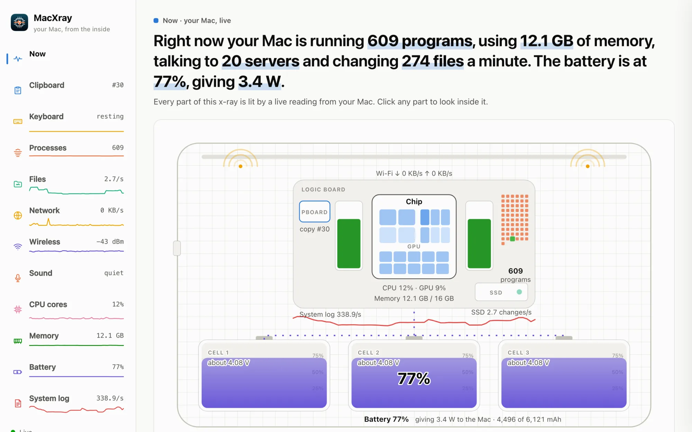

<h1 align="center">MacXray</h1>

<b>See inside your Mac.</b>

  <a href="https://github.com/victorabuchi/macxray/releases/latest/download/MacXray.dmg"><b>Download MacXray</b></a> ·
  <a href="https://victorabuchi.github.io/macxray/">Website</a> ·
  <a href="https://github.com/victorabuchi/macxray/releases">All versions</a>

MacXray shows what your Mac is doing right now, and how: every app and the processes behind it, the files they change and who they talk to, the path each keypress takes, who's using the microphone and camera, the Wi-Fi and Bluetooth radios, the chip, the memory, the battery and everything you copy. Live, and in plain English.

<picture>
  <source media="(prefers-color-scheme: dark)" srcset="docs/assets/shots/now-dark.webp">
  
</picture>

## Install

1. Download [MacXray.dmg](https://github.com/victorabuchi/macxray/releases/latest/download/MacXray.dmg).
2. Open it and drag MacXray into Applications.
3. Open MacXray. The first time, macOS asks whether you're sure. Click Open.

MacXray is free. It needs macOS Sequoia 15 or later, on Apple silicon or Intel, and it's signed with a Developer ID and notarized by Apple.

## What it shows

| View | What you see |
| --- | --- |
| Now | Your Mac drawn as an x-ray, each part lit by a live reading, with one sentence that sums it all up |
| Clipboard | Everything you copy, kept in full and in every format, with images exactly as copied, ready to copy again |
| Keyboard | How your keyboard is connected, the path each keypress takes, and every program listening to your keys (MacXray never sees which key) |
| Processes | Every program, the helpers each app splits into, and what each one is |
| Files | Which app is changing which files, sorted into your files, app data, caches, settings and logs |
| Network | Every connection, from the app that opened it to the company on the other end |
| Wireless | Wi-Fi signal, noise, channel and speed, hotspots, AirDrop's private link, Bluetooth devices and Location Services |
| Sound | Which apps use the microphone, camera and speakers (MacXray never listens or watches) |
| CPU cores | Each core's load second by second, the graphics, and how warm the chip is |
| Memory | What's in use, compressed or cached, and the pressure macOS feels |
| Battery | Charge, health, cycles, the cells inside and the power flowing in and out |
| System log | What macOS is writing in its diary, grouped by who's talking |

## Privacy

Everything stays on your Mac. MacXray has no account, no analytics and no tracking, and it can't read what you type or hear what your microphone hears. It saves only your clipboard history, in a file on your Mac, and never reads or saves copies that password managers mark as sensitive. Its only use of the network is asking your DNS server for the names of the servers your apps talk to. The [privacy policy](https://victorabuchi.github.io/macxray/privacy/) has the details.

## Help

Something not right? [Open an issue](https://github.com/victorabuchi/macxray/issues/new) with what you saw, your Mac's model and its macOS version.

## This repository

It holds MacXray's website, in `docs` (served by GitHub Pages), its downloads, in [Releases](https://github.com/victorabuchi/macxray/releases), and MacMemory, the small Swift package MacXray reads your Mac's memory with: what apps use, wired, compressed, cached and free memory, memory pressure and swap. MacMemory is free to use under the MIT License; MacXray itself is not open source, and its source code is private.

Apple, Mac, MacBook and macOS are trademarks of Apple Inc. MacXray isn't affiliated with or endorsed by Apple.
